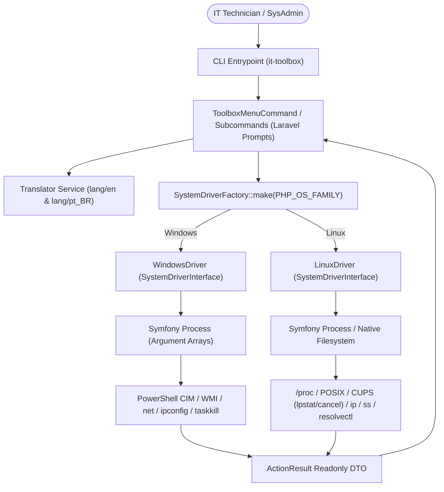

# IT Toolbox CLI (`it-toolbox`)

[](https://www.php.net/)
[](https://laravel-zero.com/)
[](https://github.com/Dev-lib4n/it-toolbox-cli/actions/workflows/ci.yml)
[](./LICENSE)

> **Language / Idioma:** **[🇺🇸 English](./README.md)** | **[🇧🇷 Português (Brasil)](./README.pt-BR.md)**

---

## Overview

**IT Toolbox CLI (`it-toolbox`)** is a cross-platform, interactive terminal utility (TUI/CLI) built with **PHP 8.3+**, **Laravel Zero**, and **Laravel Prompts**. Designed for **IT Support Technicians, Help Desk Engineers, and System Administrators**, it unifies daily troubleshooting, hardware/OS diagnostics, print spooler recovery, network health checks, and safe temporary file cleanup across both **Windows** and **Linux** (distribution-agnostic) environments from a single portable binary.

---

## Features

- **🖥 System & Hardware Diagnostics (`system`):**
  - Inspect OS metadata, kernel version, architecture, hostname, and system uptime.
  - Real-time CPU model, core/thread count, load percentage, and physical RAM usage.
  - Storage volume capacity, used/free space, and usage percentages across NTFS/ext4/btrfs/xfs filesystems.
  - Top resource-consuming processes viewer with interactive frozen process termination (`PID` kill).
- **🖨 Printers & Spooler Management (`printer`):**
  - List installed printers, driver details, ports/URIs, default status, and queue states (`PowerShell Get-Printer` on Windows / `CUPS lpstat` on Linux).
  - One-step print queue purge and spooler service restart (`net stop/start spooler` & `PRINTERS` cleanup on Windows / `cancel -a` & `systemctl restart cups` on Linux).
- **🌐 Network & Connectivity Diagnostics (`network`):**
  - Active network interface inspection (`IPv4`, `IPv6`, `MAC`, link status).
  - Automated connectivity health check (Default Gateway ping, external ICMP latency to `8.8.8.8` / `1.1.1.1`, and DNS resolution verification).
  - One-click DNS cache flush and DHCP IP lease renewal.
  - Active listening `TCP`/`UDP` ports and owning processes scanner (`Get-NetTCPConnection` / `ss -tulnp`).
- **🧹 System Maintenance & Cleanup (`maintenance`):**
  - Safe cleanup of user and system temporary directories (`%TEMP%`, `C:\Windows\Temp`, `/tmp`, `/var/tmp`, `~/.cache/thumbnails`), gracefully skipping locked/in-use files and reporting freed disk space.
- **📄 Diagnostic Reports & Export (`report`):**
  - Export complete hardware, OS, printer, and network diagnostic snapshots to structured `.txt` or `.json` files for ticketing systems and audit logs.
- **🌍 Native Bilingual Interface (`i18n`):**
  - Full support for **English (`en`)** and **Brazilian Portuguese (`pt_BR`)**, selectable via `--lang=` flag or dynamically inside the interactive TUI menu.

---

## Architecture

The project strictly separates presentation (TUI commands), orchestration, and operating-system-specific execution using the **Adapter/Driver Pattern** and **Factory Pattern**. All external OS commands are executed safely through `Symfony\Component\Process\Process` using argument arrays to prevent Command Injection.



---

## Installation & Usage

### Prerequisites
- **PHP 8.3** or higher (`cli`, `mbstring`, `pcntl` optional on Linux)
- **Composer 2.x**
- Administrator privileges (Windows) or `sudo` (Linux) recommended for privileged operations (spooler restart, system temp cleanup, DHCP renewal).

### Installation

Choose the installation method that best fits your scenario:

#### Option A: Standalone Binary (Recommended for End Users — No Composer Required)

You can download the pre-compiled, portable `it-toolbox` executable directly from the [GitHub Releases](https://github.com/Dev-lib4n/it-toolbox-cli/releases) page without cloning the repository or installing Composer:

```bash
# 1. Download the latest 'it-toolbox' binary from GitHub Releases
# 2. Run directly with PHP 8.3+
php it-toolbox

# (Optional on Linux) Make it executable and move to your PATH:
chmod +x it-toolbox
sudo mv it-toolbox /usr/local/bin/it-toolbox
it-toolbox
```

#### Option B: From Source (Development & Contributors)

If you want to contribute, customize the code, or run the automated test suite:

```bash
# 1. Clone the repository
git clone https://github.com/Dev-lib4n/it-toolbox-cli.git
cd it-toolbox-cli

# 2. Install dependencies via Composer
composer install
```

### Interactive TUI Mode

Launch the interactive dashboard. If `--lang` is omitted, an interactive language selector is presented on startup:

```bash
# Launch with interactive language selector
php it-toolbox

# Launch directly in English
php it-toolbox --lang=en

# Launch directly in Brazilian Portuguese
php it-toolbox --lang=pt_BR
```

### Direct CLI Subcommands

Every module can also be executed directly in headless/CLI scripts or terminal sessions:

| Command | Module | Description | Options |
| :--- | :--- | :--- | :--- |
| `php it-toolbox menu` | Core TUI | Launch the interactive TUI main menu (default command) | `--lang=en\|pt_BR`, `--once` |
| `php it-toolbox system:info` | System | Display OS, CPU, RAM, and disk health metrics | `--lang=en\|pt_BR` |
| `php it-toolbox system:top` | System | List top processes by resource usage and optionally kill a PID | `--limit=10`, `--lang=en\|pt_BR` |
| `php it-toolbox printer:list` | Printers | List installed printers, drivers, ports, and status | `--lang=en\|pt_BR` |
| `php it-toolbox printer:clear` | Printers | Restart print spooler / CUPS and purge stuck print jobs | `--force`, `--lang=en\|pt_BR` |
| `php it-toolbox network:check` | Network | Inspect network interfaces and run ping/DNS health checks | `--lang=en\|pt_BR` |
| `php it-toolbox network:flush` | Network | Flush DNS resolver cache and renew DHCP lease | `--force`, `--lang=en\|pt_BR` |
| `php it-toolbox network:ports` | Network | List active listening TCP/UDP ports and owning processes | `--lang=en\|pt_BR` |
| `php it-toolbox clean:temp` | Maintenance | Safely purge temporary files and report freed space | `--force`, `--lang=en\|pt_BR` |
| `php it-toolbox report:export` | Reports | Export full system diagnostic report to `.md` and/or `.json` | `--format=md\|json\|both`, `--output=DIR`, `--lang=en\|pt_BR` |

---

## Build & Tests

### Compiling Standalone PHAR Binary

Compile the application into a single distributable `.phar` executable (`builds/it-toolbox`):

```bash
php it-toolbox app:build it-toolbox --build-version=1.0.0
```

### Running the Test Suite

The test suite is powered by **Pest PHP** and mocks OS-level processes so all tests run deterministically on both Windows and Linux CI runners:

```bash
# Run all Unit and Feature tests
./vendor/bin/pest

# Check code style with Laravel Pint
./vendor/bin/pint --test
```

---

## Tech Stack & Design Patterns

- **Language & Runtime:** PHP 8.3+ (`declare(strict_types=1)`, typed properties, `match` expressions, `readonly` classes)
- **Micro-Framework:** [Laravel Zero](https://laravel-zero.com/)
- **Terminal UI (TUI):** [Laravel Prompts](https://laravel.com/docs/prompts) (`select`, `table`, `spin`, `confirm`, `info`, `warning`, `error`)
- **Process Execution:** `Symfony\Component\Process\Process` (strictly array-based arguments for Command Injection prevention)
- **Internationalization:** `Illuminate\Translation` (`lang/en` & `lang/pt_BR`)
- **Architectural Patterns:**
  - **Adapter / Driver Pattern:** `SystemDriverInterface` implemented by `WindowsDriver` and `LinuxDriver`.
  - **Factory Pattern:** `SystemDriverFactory` dynamically resolves the driver via `PHP_OS_FAMILY`.
  - **Data Transfer Objects (DTO):** Immutable `readonly class ActionResult` for standardized operation outcomes.
- **Testing & QA:** Pest PHP, Mockery, Laravel Pint, and GitHub Actions CI across Ubuntu and Windows runners.

---

## License

This project is open-sourced software licensed under the [MIT License](./LICENSE).
Copyright (c) 2026 **Ian Carlos Pinheiro Libanio da Silva**.
