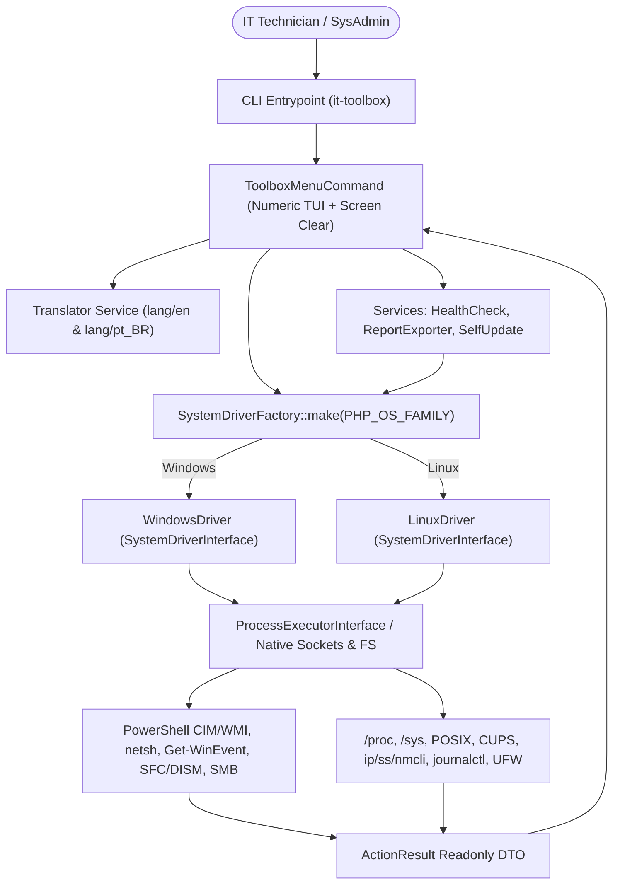

# IT Toolbox CLI (`it-toolbox`)

[](https://www.php.net/)
[](https://laravel-zero.com/)
[](https://github.com/Dev-lib4n/it-toolbox-cli/actions/workflows/ci.yml)
[](./LICENSE)

> **Language / Idioma:** **[🇺🇸 English](./README.md)** | **[🇧🇷 Português (Brasil)](./README.pt-BR.md)**

---

## Overview

**IT Toolbox CLI (`it-toolbox`)** is a cross-platform, interactive terminal utility (TUI/CLI) built with **PHP 8.3+**, **Laravel Zero**, and **Laravel Prompts**. Designed for **IT Support Technicians, Help Desk Engineers, and System Administrators**, it unifies **35+ diagnostic, maintenance, security, printer, network, and asset inventory tools** across both **Windows** and **Linux** (distribution-agnostic) environments from a single zero-dependency standalone binary.

---

## Features (`v2.0.0`)

- **🩺 Full Machine Health Check & Score (`health:check`):**
  - Calculates an objective **0–100 Health Score** across RAM usage, disk storage, internet/DNS connectivity, print queue state, and critical OS logs, classifying the workstation into **Healthy (`80–100`)**, **Warning (`50–79`)**, or **Critical (`0–49`)** with visual progress bar, checklist (`✅` / `⚠️` / `❌`), and actionable remediation recommendations.
- **🖥 System, Hardware & Services (`system`):**
  - `system:info`: OS metadata, kernel/build, CPU model/load, physical RAM, and disk usage alerts (`> 85%`).
  - `system:top` & `system:kill`: Top resource-consuming processes viewer and force-termination by PID, name, or interactive selection.
  - `system:logs`: Critical & error OS event logs from the last 24h (`Get-WinEvent` / `journalctl -p err` / `/var/log/syslog`).
  - `system:services`: Status and one-click restart for critical support services (`Spooler`, `wuauserv`, `BITS`, `Dnscache`, `AnyDesk`, `TeamViewer`, `cups`, `ssh`, `docker`, `nginx`, `NetworkManager`).
  - `system:battery`: Laptop battery charge, design vs full capacity (mWh), wear percentage, and cycle count.
  - `system:startup`: Boot & login startup programs (`Win32_StartupCommand` / `systemctl list-unit-files --state=enabled`).
  - `system:usb`: Connected USB controllers and peripherals (`Get-PnpDevice` / `lsusb`).
  - `system:env`: Environment variable inspector and `PATH` directory auditor (`✅ Valid`, `❌ Missing/Broken`, `⚠️ Duplicate`).
- **🖨 Printers & Spooler Management (`printer`):**
  - `printer:list` & `printer:clear`: List installed printers, drivers, ports/URIs, pending jobs, and restart Print Spooler / CUPS purging stuck queues.
  - `printer:test-page` & `printer:default`: Send a diagnostic test page (`Win32_Printer.PrintTestPage` / `lp -d`) and switch the system default printer (`SetDefaultPrinter` / `lpoptions -d`).
- **🌐 Advanced Network & Connectivity (`network`):**
  - `network:check`, `network:flush` & `network:ports`: Interfaces (IPv4/IPv6/Gateway/DNS/MAC), cascade connectivity test, DNS flush, and active listening ports (`Get-NetTCPConnection` / `ss -tulnp`).
  - `network:probe`: Native TCP port connection probe with millisecond latency measurement (`OPEN` / `CLOSED` / `TIMEOUT`).
  - `network:wifi`: Wireless signal strength (`%`), SSID, BSSID, channel, band, and RX/TX link speeds (`netsh wlan` / `nmcli` / `iw`).
  - `network:reset`: Full network stack & DHCP reset (`ipconfig /release`, `netsh winsock reset`, `netsh int ip reset`, `ipconfig /renew` / `NetworkManager` & `dhclient`).
  - `network:ssl`: Live HTTPS SSL/TLS certificate inspector (CN, Issuer, expiration date, `< 30` days warning, SANs).
  - `network:scan`: Local Area Network (LAN) active devices discovery via ARP & neighbor cache.
  - `network:public`: External Public IP, City/Region/Country, ISP/ASN, and reverse hostname lookup.
- **🧹 System Maintenance & Cleanup (`maintenance`):**
  - `clean:temp`: Safe cleanup of user/system temp directories (`%TEMP%`, `C:\Windows\Temp`, `/tmp`, `/var/tmp`) + DNS flush / `journalctl --vacuum-time=3d`.
  - `maintenance:browsers`: Cleans **only** cache directories for Chrome, Edge, and Firefox (preserving passwords, history, cookies, and bookmarks).
  - `maintenance:large-files`: Recursive scanner locating the largest disk-consuming files cleanly.
  - `maintenance:repair`: OS image & package integrity verification (`sfc /scannow` + `DISM` / `dpkg --audit` / `apt-get check` / `rpm -Va` / `pacman -Qk`).
  - `maintenance:updates` & `maintenance:scheduler`: Pending OS/package updates (`Microsoft.Update.Session` / `apt` / `dnf` / `pacman`) and active non-system scheduled tasks, cron jobs & systemd timers.
- **🛡 Security & Access Auditing (`security`):**
  - `security:audit`: Unified posture check for Firewall (`Windows Defender Firewall` / `ufw` / `firewalld` / `nftables`), Antivirus/MAC (`Microsoft Defender` / `AppArmor` / `SELinux`), and Elevation Policy (`UAC` / `SSH PermitRootLogin`).
  - `security:users`: Local accounts audit highlighting `Administrators` / `sudo` / `wheel` / `root` members.
  - `security:shares`: Active SMB, Samba, and NFS network shares inspector.
  - `security:hosts`: System `hosts` file parser alerting on custom overrides and external domain redirections.
- **📄 Reports, Asset Inventory & Benchmark (`report` / `toolbox`):**
  - `report:export`: Export full diagnostic snapshots to structured `.md` and `.json` files.
  - `toolbox:inventory`: Corporate IT asset technical sheet (Hostname, Manufacturer, Model, BIOS Serial Number, RAM modules, Physical SSD/HDD/NVMe drives, MAC addresses) ready for GLPI / CMDB export.
  - `toolbox:benchmark`: Zero-dependency CPU single-core (`SHA-256` ops/sec) and 64 MB sequential Disk I/O (`MB/s` write/read) micro-benchmark.
- **⬆️ Over-the-Air Self-Update (`self:update`) & Bilingual Numeric TUI (`en` / `pt_BR`):**
  - Fast numeric keyboard navigation (`[1]`–`[9]`, `[0]`) with automatic terminal screen clearing, privilege badge (`Admin / Root` vs `Standard User`), and atomic GitHub Releases self-updating.

---

## Architecture

The project strictly separates presentation (numeric TUI commands), domain services, and operating-system-specific execution using the **Adapter/Driver Pattern**, **Factory Pattern**, and **Process Executor Abstraction**. All external OS commands execute safely via `Symfony\Component\Process\Process` using argument arrays to prevent Command Injection.



---

## Installation & Usage

Choose the installation method that best fits your scenario:

#### Option 1: Native Standalone Binary (Zero Dependencies — No PHP or Composer Required)

Ideal for field IT technicians and target workstations. Download the self-contained native executable (powered by `static-php-cli` `micro.sfx`) directly from the [GitHub Releases](https://github.com/Dev-lib4n/it-toolbox-cli/releases) page and run it immediately without installing PHP or Composer:

**Windows (x64):**
```powershell
# If Windows SmartScreen blocks the downloaded executable from the internet, unblock it first:
Unblock-File -Path .\it-toolbox-windows-x64.exe

# Run the interactive TUI:
.\it-toolbox-windows-x64.exe

# Or launch directly in your preferred language:
.\it-toolbox-windows-x64.exe --lang=en
.\it-toolbox-windows-x64.exe --lang=pt_BR
```

> **Windows SmartScreen Note:** Because `it-toolbox-windows-x64.exe` is an unsigned open-source binary downloaded from GitHub, Windows Defender SmartScreen may display a prompt on first launch. You can either run `Unblock-File -Path .\it-toolbox-windows-x64.exe` in PowerShell or click **More info → Run anyway**.

**Linux (x64):**
```bash
# Download 'it-toolbox-linux-x64' from GitHub Releases, grant execution permission, and run:
chmod +x it-toolbox-linux-x64
./it-toolbox-linux-x64

# (Optional) Install globally in PATH:
sudo mv it-toolbox-linux-x64 /usr/local/bin/it-toolbox
it-toolbox
```

#### Option 2: Portable PHAR (Requires PHP 8.3+)

If your machine already has **PHP 8.3+** installed, download the cross-platform `it-toolbox` PHAR archive from [GitHub Releases](https://github.com/Dev-lib4n/it-toolbox-cli/releases):

```bash
php it-toolbox
```

#### Option 3: From Source (Requires PHP 8.3+ & Composer 2.x)

For developers who want to customize the source code or run the automated test suite:

```bash
# 1. Clone the repository
git clone https://github.com/Dev-lib4n/it-toolbox-cli.git
cd it-toolbox-cli

# 2. Install dependencies via Composer
composer install
```

> **Note:** Administrator privileges (Windows) or `sudo` (Linux) are recommended for privileged system operations (spooler restart, OS repair, network stack reset, service restarts, and system temp cleanup).

### Interactive TUI Mode

Launch the interactive numeric dashboard. If `--lang` is omitted, an interactive language selector is presented on startup:

```bash
php it-toolbox
php it-toolbox --lang=en
php it-toolbox --lang=pt_BR
```

### Direct CLI Subcommands

Every module can also be executed directly in headless/CLI scripts or terminal sessions:

| Command | Module | Description | Options |
| :--- | :--- | :--- | :--- |
| `php it-toolbox menu` | Core TUI | Launch the interactive numeric TUI main menu (default) | `--lang=en\|pt_BR`, `--once` |
| `php it-toolbox health:check` | Health | Run full machine health audit with 0–100 score & tips | `--export`, `--lang=en\|pt_BR` |
| `php it-toolbox system:info` | System | Display OS, CPU, RAM, and disk health metrics | `--lang=en\|pt_BR` |
| `php it-toolbox system:top` | System | List top processes by resource usage and kill a PID | `--limit=10`, `--lang=en\|pt_BR` |
| `php it-toolbox system:logs` | System | Inspect critical/error OS log events (last 24h) | `--limit=15`, `--lang=en\|pt_BR` |
| `php it-toolbox system:services` | System | Inspect critical IT support services & restart one | `--restart=NAME`, `--lang=en\|pt_BR` |
| `php it-toolbox system:battery` | System | Inspect laptop battery health, capacity & wear | `--lang=en\|pt_BR` |
| `php it-toolbox system:startup` | System | List boot & login startup programs / services | `--lang=en\|pt_BR` |
| `php it-toolbox system:usb` | System | List connected USB controllers & peripherals | `--lang=en\|pt_BR` |
| `php it-toolbox system:env` | System | Inspect env variables & audit PATH entries | `--lang=en\|pt_BR` |
| `php it-toolbox system:kill` | System | Force-kill process by PID, name, or top-10 menu | `[target]`, `--force`, `--lang=en\|pt_BR` |
| `php it-toolbox printer:list` | Printers | List installed printers, drivers, ports, and jobs | `--lang=en\|pt_BR` |
| `php it-toolbox printer:clear` | Printers | Restart print spooler / CUPS and purge print queue | `--force`, `--lang=en\|pt_BR` |
| `php it-toolbox printer:test-page` | Printers | Send a diagnostic test page to an installed printer | `[printer]`, `--lang=en\|pt_BR` |
| `php it-toolbox printer:default` | Printers | Set the system default printer | `[printer]`, `--lang=en\|pt_BR` |
| `php it-toolbox network:check` | Network | Inspect network interfaces & run ping/DNS check | `--lang=en\|pt_BR` |
| `php it-toolbox network:flush` | Network | Flush DNS resolver cache and renew DHCP lease | `--force`, `--lang=en\|pt_BR` |
| `php it-toolbox network:ports` | Network | List active listening TCP/UDP ports & processes | `--lang=en\|pt_BR` |
| `php it-toolbox network:probe` | Network | Test remote TCP port connectivity & latency (ms) | `[host] [port]`, `--timeout=3`, `--lang=...` |
| `php it-toolbox network:wifi` | Network | Inspect Wi-Fi SSID, BSSID, signal %, channel & speed | `--lang=en\|pt_BR` |
| `php it-toolbox network:reset` | Network | Full network stack reset (Winsock/IP/NetworkManager) | `--force`, `--lang=en\|pt_BR` |
| `php it-toolbox network:ssl` | Network | Inspect HTTPS SSL/TLS certificate & days remaining | `[domain]`, `--port=443`, `--lang=en\|pt_BR` |
| `php it-toolbox network:scan` | Network | Discover active LAN devices from ARP / neighbor table | `--lang=en\|pt_BR` |
| `php it-toolbox network:public` | Network | Query external public IP, geolocation, ISP & PTR | `--lang=en\|pt_BR` |
| `php it-toolbox clean:temp` | Maintenance | Safely purge temporary files and report freed space | `--force`, `--lang=en\|pt_BR` |
| `php it-toolbox maintenance:browsers` | Maintenance | Clean Chrome, Edge & Firefox cache directories only | `--force`, `--lang=en\|pt_BR` |
| `php it-toolbox maintenance:large-files` | Maintenance | Find the top largest files consuming disk space | `[path]`, `--limit=15`, `--lang=en\|pt_BR` |
| `php it-toolbox maintenance:repair` | Maintenance | Verify/repair OS files & packages (SFC/DISM/dpkg) | `--force`, `--lang=en\|pt_BR` |
| `php it-toolbox maintenance:updates` | Maintenance | Check pending OS patches & package updates | `--lang=en\|pt_BR` |
| `php it-toolbox maintenance:scheduler` | Maintenance | List active scheduled tasks, cron jobs & timers | `--lang=en\|pt_BR` |
| `php it-toolbox security:audit` | Security | Audit Firewall, Antivirus/MAC & UAC/SSH policy | `--lang=en\|pt_BR` |
| `php it-toolbox security:users` | Security | Audit local user accounts & Admin/sudo membership | `--lang=en\|pt_BR` |
| `php it-toolbox security:shares` | Security | List active SMB, Samba, and NFS network shares | `--lang=en\|pt_BR` |
| `php it-toolbox security:hosts` | Security | Audit system hosts file for custom/external redirects | `--lang=en\|pt_BR` |
| `php it-toolbox report:export` | Reports | Export full system diagnostic report (`.md` / `.json`) | `--format=md\|json\|both`, `--output=DIR`, `--lang=...` |
| `php it-toolbox toolbox:inventory` | Asset | Generate GLPI/CMDB hardware & BIOS serial inventory | `--export`, `--lang=en\|pt_BR` |
| `php it-toolbox toolbox:benchmark` | Diagnostic | Run CPU SHA-256 & 64 MB sequential Disk I/O bench | `--lang=en\|pt_BR` |
| `php it-toolbox self:update` | Core CLI | Check GitHub Releases and self-update executable | `--check`, `--lang=en\|pt_BR` |

---

## Build & Tests

### Compiling Standalone PHAR & Native Binaries

Compile the application into a portable `.phar` (`builds/it-toolbox`) or bundle it with `static-php-cli` (`micro.sfx`) into zero-dependency native executables (`builds/it-toolbox-linux-x64` and `builds/it-toolbox-windows-x64.exe`):

```bash
# Build portable PHAR only
php -d phar.readonly=0 it-toolbox app:build it-toolbox --build-version=2.0.0

# Build PHAR + Native Linux & Windows x64 standalone binaries
./scripts/build-standalone.sh 2.0.0
```

### Running the Test Suite

The test suite is powered by **Pest PHP** and mocks OS-level processes via `ProcessExecutorInterface` so all tests run deterministically on both Windows and Linux CI runners:

```bash
# Run all Unit and Feature tests
./vendor/bin/pest

# Check code style with Laravel Pint
./vendor/bin/pint --test
```

---

## Tech Stack & Design Patterns

- **Language & Runtime:** PHP 8.3+ (`declare(strict_types=1)`, typed properties, `match` expressions, `readonly` classes)
- **Micro-Framework:** [Laravel Zero](https://laravel-zero.com/)
- **Terminal UI (TUI):** [Laravel Prompts](https://laravel.com/docs/prompts) + Custom Cross-Platform Numeric TTY Navigation (`InteractsWithTerminal`)
- **Process Execution:** `Symfony\Component\Process\Process` abstracted behind `ProcessExecutorInterface` (strictly array-based arguments for Command Injection prevention)
- **Internationalization:** `Illuminate\Translation` (`lang/en` & `lang/pt_BR` with 100% key parity enforced by CI tests)
- **Architectural Patterns:**
  - **Adapter / Driver Pattern:** `SystemDriverInterface` implemented by `WindowsDriver` and `LinuxDriver`.
  - **Factory Pattern:** `SystemDriverFactory` dynamically resolves the driver via `PHP_OS_FAMILY`.
  - **Data Transfer Objects (DTO):** Immutable `readonly class ActionResult` and `ProcessResult`.
- **Testing & QA:** Pest PHP, Mockery, Laravel Pint, and GitHub Actions CI across Ubuntu and Windows runners.

---

## License

This project is open-sourced software licensed under the [MIT License](./LICENSE).
Copyright (c) 2026 **Ian Carlos Pinheiro Libanio da Silva**.
