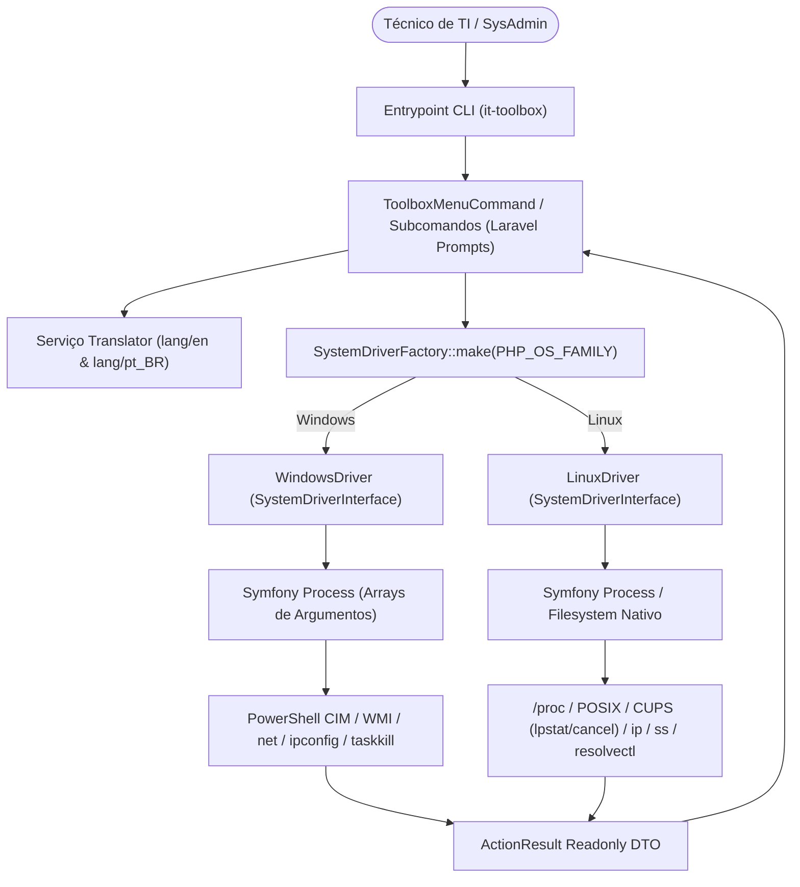

# IT Toolbox CLI (`it-toolbox`)

[](https://www.php.net/)
[](https://laravel-zero.com/)
[](https://github.com/Dev-lib4n/it-toolbox-cli/actions/workflows/ci.yml)
[](./LICENSE)

> **Language / Idioma:** **[🇺🇸 English](./README.md)** | **[🇧🇷 Português (Brasil)](./README.pt-BR.md)**

---

## Visão Geral

O **IT Toolbox CLI (`it-toolbox`)** é um utilitário interativo de terminal (TUI/CLI) multiplataforma desenvolvido em **PHP 8.3+**, **Laravel Zero** e **Laravel Prompts**. Projetado para **Técnicos de Suporte de TI, Analistas de Help Desk e Administradores de Sistemas (SysAdmins)**, ele centraliza tarefas diárias de diagnóstico de hardware e SO, recuperação de filas de impressão (spooler/CUPS), testes de saúde de rede e limpeza segura de arquivos temporários em ambientes **Windows** e **Linux** (agnóstico de distribuição) a partir de um único binário portátil.

---

## Funcionalidades

- **🖥 Diagnóstico de Sistema e Hardware (`system`):**
  - Inspeção de metadados do SO, versão do kernel, arquitetura, hostname e tempo de atividade (`uptime`).
  - Modelo da CPU, contagem de núcleos/threads, percentual de carga em tempo real e uso de memória RAM física.
  - Capacidade de volumes de armazenamento, espaço usado/livre e percentual de ocupação em sistemas de arquivos NTFS/ext4/btrfs/xfs.
  - Visualizador dos processos de maior consumo com opção interativa para encerrar tarefas travadas (`kill PID`).
- **🖨 Gerenciamento de Impressoras e Spooler (`printer`):**
  - Listagem de impressoras instaladas, detalhes de drivers, portas/URIs, impressora padrão e status da fila (`PowerShell Get-Printer` no Windows / `CUPS lpstat` no Linux).
  - Limpeza automatizada de fila de impressão e reinicialização do serviço de spooler (`net stop/start spooler` e limpeza de `PRINTERS` no Windows / `cancel -a` e `systemctl restart cups` no Linux).
- **🌐 Diagnóstico de Rede e Conectividade (`network`):**
  - Inspeção de interfaces de rede ativas (`IPv4`, `IPv6`, `MAC`, estado do link).
  - Verificação automatizada de saúde de conectividade (Ping para o Gateway Padrão, latência ICMP externa para `8.8.8.8` / `1.1.1.1` e validação de resolução DNS).
  - Limpeza de cache DNS e renovação de concessão DHCP com um comando.
  - Scanner de portas `TCP`/`UDP` abertas em escuta e processos proprietários (`Get-NetTCPConnection` / `ss -tulnp`).
- **🧹 Manutenção e Limpeza do Sistema (`maintenance`):**
  - Limpeza segura de diretórios temporários de usuário e sistema (`%TEMP%`, `C:\Windows\Temp`, `/tmp`, `/var/tmp`, `~/.cache/thumbnails`), ignorando arquivos em uso/bloqueados com segurança e contabilizando o espaço em disco liberado.
- **📄 Relatórios de Diagnóstico e Exportação (`report`):**
  - Exportação de relatórios completos de diagnóstico de hardware, SO, impressoras e rede nos formatos `.txt` ou `.json` para anexação em chamados técnicos e auditorias.
- **🌍 Interface Bilíngue Nativa (`i18n`):**
  - Suporte completo para **Inglês (`en`)** e **Português do Brasil (`pt_BR`)**, selecionável via flag `--lang=` ou dinamicamente dentro do menu interativo TUI.

---

## Arquitetura

O projeto separa estritamente a camada de apresentação (comandos TUI), orquestração e execução específica de cada sistema operacional utilizando **Adapter/Driver Pattern** e **Factory Pattern**. Todos os comandos externos do SO são executados de forma segura via `Symfony\Component\Process\Process` utilizando arrays de argumentos para prevenir *Command Injection*.



---

## Instalação e Uso

Escolha o método de instalação ideal para o seu cenário:

#### Opção 1: Binário Nativo Standalone (Zero Dependências — Sem PHP ou Composer)

Ideal para técnicos de TI em campo e máquinas de clientes. Baixe o executável nativo autossuficiente (empacotado com `static-php-cli` `micro.sfx`) diretamente na aba [Releases do GitHub](https://github.com/Dev-lib4n/it-toolbox-cli/releases) e execute imediatamente sem precisar ter PHP ou Composer instalados:

**Windows (x64):**
```powershell
# Baixe 'it-toolbox-windows-x64.exe' na aba Releases do GitHub e execute:
.\it-toolbox-windows-x64.exe

# Ou inicie diretamente no idioma desejado:
.\it-toolbox-windows-x64.exe --lang=pt_BR
.\it-toolbox-windows-x64.exe --lang=en
```

**Linux (x64):**
```bash
# Baixe 'it-toolbox-linux-x64' na aba Releases, conceda permissão de execução e rode:
chmod +x it-toolbox-linux-x64
./it-toolbox-linux-x64

# (Opcional) Instale globalmente no PATH:
sudo mv it-toolbox-linux-x64 /usr/local/bin/it-toolbox
it-toolbox
```

#### Opção 2: Arquivo PHAR Portátil (Requer PHP 8.3+)

Caso a máquina já possua o **PHP 8.3+** instalado, você pode baixar o pacote multiplataforma `it-toolbox` (`.phar`) na aba [Releases do GitHub](https://github.com/Dev-lib4n/it-toolbox-cli/releases):

```bash
php it-toolbox
```

#### Opção 3: A partir do Código-Fonte (Requer PHP 8.3+ & Composer 2.x)

Para desenvolvedores que desejam customizar o código ou executar a suíte de testes automatizados:

```bash
# 1. Clone o repositório
git clone https://github.com/Dev-lib4n/it-toolbox-cli.git
cd it-toolbox-cli

# 2. Instale as dependências via Composer
composer install
```

> **Nota:** Privilégios de Administrador (Windows) ou `sudo` (Linux) são recomendados para operações privilegiadas do sistema (reinício do spooler, limpeza temporária do sistema e renovação DHCP).

### Modo Interativo (TUI)

Inicie o painel interativo. Caso a flag `--lang` seja omitida, o seletor interativo de idioma será exibido na inicialização:

```bash
# Iniciar com seletor interativo de idioma
php it-toolbox

# Iniciar diretamente em Português (Brasil)
php it-toolbox --lang=pt_BR

# Iniciar diretamente em Inglês
php it-toolbox --lang=en
```

### Subcomandos Diretos via CLI

Cada módulo também pode ser executado diretamente em scripts ou sessões rápidas de terminal:

| Comando | Módulo | Descrição | Opções |
| :--- | :--- | :--- | :--- |
| `php it-toolbox menu` | Core TUI | Inicia o menu principal interativo TUI (comando padrão) | `--lang=en\|pt_BR`, `--once` |
| `php it-toolbox system:info` | Sistema | Exibe métricas de SO, CPU, RAM e saúde de discos | `--lang=en\|pt_BR` |
| `php it-toolbox system:top` | Sistema | Lista os processos de maior consumo e permite encerrar um PID | `--limit=10`, `--lang=en\|pt_BR` |
| `php it-toolbox printer:list` | Impressoras | Lista impressoras instaladas, drivers, portas e status | `--lang=en\|pt_BR` |
| `php it-toolbox printer:clear` | Impressoras | Reinicia o Spooler / CUPS e limpa trabalhos de impressão travados | `--force`, `--lang=en\|pt_BR` |
| `php it-toolbox network:check` | Rede | Inspeciona interfaces de rede e executa testes de ping e DNS | `--lang=en\|pt_BR` |
| `php it-toolbox network:flush` | Rede | Limpa o cache DNS e renova a concessão de IP via DHCP | `--force`, `--lang=en\|pt_BR` |
| `php it-toolbox network:ports` | Rede | Lista portas TCP/UDP em escuta e seus respectivos processos | `--lang=en\|pt_BR` |
| `php it-toolbox clean:temp` | Manutenção | Limpa diretórios temporários com segurança e exibe espaço liberado | `--force`, `--lang=en\|pt_BR` |
| `php it-toolbox report:export` | Relatórios | Exporta relatório completo de diagnóstico em `.md` e/ou `.json` | `--format=md\|json\|both`, `--output=DIR`, `--lang=en\|pt_BR` |

---

## Compilação e Testes

### Compilando o Binário PHAR e Executáveis Nativos Standalone

Compile a aplicação em um arquivo `.phar` portátil (`builds/it-toolbox`) ou empacote-a junto com o runtime `static-php-cli` (`micro.sfx`) gerando executáveis nativos sem dependências (`builds/it-toolbox-linux-x64` e `builds/it-toolbox-windows-x64.exe`):

```bash
# Compilar apenas o PHAR portátil
php it-toolbox app:build it-toolbox --build-version=1.0.0

# Compilar PHAR + Binários Nativos Standalone (Linux & Windows x64)
./scripts/build-standalone.sh 1.0.0
```

### Executando a Suíte de Testes

A suíte de testes utiliza **Pest PHP** com mocks dos processos do sistema operacional para que todos os testes rodem de forma determinística tanto no Windows quanto no Linux (CI):

```bash
# Executar todos os testes Unitários e de Feature
./vendor/bin/pest

# Verificar padronização de código com Laravel Pint
./vendor/bin/pint --test
```

---

## Tech Stack & Design Patterns

- **Linguagem & Runtime:** PHP 8.3+ (`declare(strict_types=1)`, propriedades tipadas, expressões `match`, classes `readonly`)
- **Micro-Framework:** [Laravel Zero](https://laravel-zero.com/)
- **Interface de Terminal (TUI):** [Laravel Prompts](https://laravel.com/docs/prompts) (`select`, `table`, `spin`, `confirm`, `info`, `warning`, `error`)
- **Execução de Processos:** `Symfony\Component\Process\Process` (uso estrito de arrays de argumentos para prevenção de *Command Injection*)
- **Internacionalização:** `Illuminate\Translation` (`lang/en` & `lang/pt_BR`)
- **Padrões de Projeto (Design Patterns):**
  - **Adapter / Driver Pattern:** `SystemDriverInterface` implementada por `WindowsDriver` e `LinuxDriver`.
  - **Factory Pattern:** `SystemDriverFactory` resolve dinamicamente o driver ativo via `PHP_OS_FAMILY`.
  - **Data Transfer Objects (DTO):** `readonly class ActionResult` imutável para retorno padronizado de operações.
- **Testes & Qualidade:** Pest PHP, Mockery, Laravel Pint e GitHub Actions CI em runners Ubuntu e Windows.

---

## Licença

Este projeto é um software de código aberto licenciado sob a [MIT License](./LICENSE).
Copyright (c) 2026 **Ian Carlos Pinheiro Libanio da Silva**.
