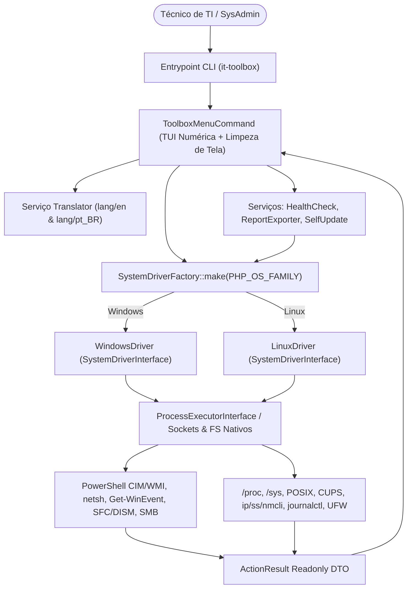

# IT Toolbox CLI (`it-toolbox`)

[](https://www.php.net/)
[](https://laravel-zero.com/)
[](https://github.com/Dev-lib4n/it-toolbox-cli/actions/workflows/ci.yml)
[](./LICENSE)

> **Language / Idioma:** **[🇺🇸 English](./README.md)** | **[🇧🇷 Português (Brasil)](./README.pt-BR.md)**

---

## Visão Geral

O **IT Toolbox CLI (`it-toolbox`)** é um utilitário interativo de terminal (TUI/CLI) multiplataforma desenvolvido em **PHP 8.3+**, **Laravel Zero** e **Laravel Prompts**. Projetado para **Técnicos de Suporte de TI, Analistas de Help Desk e Administradores de Sistemas (SysAdmins)**, ele centraliza **mais de 35 ferramentas de diagnóstico, manutenção, segurança, impressoras, rede e inventário patrimonial** em ambientes **Windows** e **Linux** (agnóstico de distribuição) a partir de um único binário autossuficiente sem dependências.

---

## Funcionalidades (`v2.0.0`)

- **🩺 Check-up Geral & Score de Saúde da Máquina (`health:check`):**
  - Calcula um **Score de Saúde objetivo de 0 a 100 pontos** auditando consumo de RAM, armazenamento em disco, conectividade externa/DNS, fila de impressão e logs críticos do SO, classificando a máquina em **Saudável (`80–100`)**, **Atenção (`50–79`)** ou **Crítico (`0–49`)** com barra visual de integridade, checklist (`✅` / `⚠️` / `❌`) e recomendações práticas de correção.
- **🖥 Sistema, Hardware & Serviços (`system`):**
  - `system:info`: Metadados do SO, kernel/build, modelo/carga de CPU, RAM física e alerta de discos (`> 85%`).
  - `system:top` & `system:kill`: Visualizador dos processos que mais consomem recursos e encerramento forçado por PID, nome ou seleção numérica.
  - `system:logs`: Eventos críticos e erros do SO nas últimas 24h (`Get-WinEvent` / `journalctl -p err` / `/var/log/syslog`).
  - `system:services`: Status e reinicialização rápida de serviços críticos de suporte (`Spooler`, `wuauserv`, `BITS`, `Dnscache`, `AnyDesk`, `TeamViewer`, `cups`, `ssh`, `docker`, `nginx`, `NetworkManager`).
  - `system:battery`: Nível de carga, capacidade projetada vs atual (mWh), desgaste e ciclos da bateria.
  - `system:startup`: Programas e serviços configurados na inicialização/boot (`Win32_StartupCommand` / `systemctl list-unit-files --state=enabled`).
  - `system:usb`: Controladores e periféricos USB conectados (`Get-PnpDevice` / `lsusb`).
  - `system:env`: Auditoria de variáveis de ambiente e validação de diretórios do `PATH` (`✅ Válido`, `❌ Inexistente/Quebrado`, `⚠️ Duplicado`).
- **🖨 Gerenciamento de Impressoras e Spooler (`printer`):**
  - `printer:list` & `printer:clear`: Listagem de impressoras, drivers, portas/URIs, jobs pendentes e reinício do Spooler / CUPS com limpeza da fila.
  - `printer:test-page` & `printer:default`: Envio de página de teste diagnóstica (`Win32_Printer.PrintTestPage` / `lp -d`) e definição da impressora padrão (`SetDefaultPrinter` / `lpoptions -d`).
- **🌐 Diagnóstico Avançado de Rede & Conectividade (`network`):**
  - `network:check`, `network:flush` & `network:ports`: Interfaces (IPv4/IPv6/Gateway/DNS/MAC), teste em cascata, limpeza de DNS e portas em escuta (`Get-NetTCPConnection` / `ss -tulnp`).
  - `network:probe`: Teste de porta TCP remota com medição de latência em milissegundos (`OPEN` / `CLOSED` / `TIMEOUT`).
  - `network:wifi`: Qualidade do sinal Wi-Fi (`%`), SSID, BSSID, canal, banda e velocidade RX/TX (`netsh wlan` / `nmcli` / `iw`).
  - `network:reset`: Reset completo da pilha de rede e DHCP (`ipconfig /release`, `netsh winsock reset`, `netsh int ip reset`, `ipconfig /renew` / `NetworkManager` & `dhclient`).
  - `network:ssl`: Inspetor de certificado SSL/TLS HTTPS (CN, Emissor, validade, alerta `< 30` dias e SANs).
  - `network:scan`: Descoberta de dispositivos ativos na rede local (LAN) via tabela ARP / vizinhos.
  - `network:public`: Consulta de IP público externo, Cidade/Região/País, Provedor (ISP/ASN) e Hostname reverso.
- **🧹 Manutenção Avançada & Limpeza (`maintenance`):**
  - `clean:temp`: Limpeza segura de diretórios temporários (`%TEMP%`, `C:\Windows\Temp`, `/tmp`, `/var/tmp`) + flush DNS / `journalctl --vacuum-time=3d`.
  - `maintenance:browsers`: Limpa **exclusivamente** arquivos de cache do Chrome, Edge e Firefox (preservando senhas, histórico, cookies e favoritos).
  - `maintenance:large-files`: Varredura recursiva para localizar os maiores arquivos ocupando espaço em disco.
  - `maintenance:repair`: Verificação e reparo de integridade de arquivos/pacotes do SO (`sfc /scannow` + `DISM` / `dpkg --audit` / `apt-get check` / `rpm -Va` / `pacman -Qk`).
  - `maintenance:updates` & `maintenance:scheduler`: Atualizações pendentes (`Microsoft.Update.Session` / `apt` / `dnf` / `pacman`) e tarefas agendadas, cron jobs & systemd timers ativos.
- **🛡 Segurança & Auditoria de Acesso (`security`):**
  - `security:audit`: Painel unificado verificando Firewall (`Windows Defender Firewall` / `ufw` / `firewalld` / `nftables`), Antivírus/MAC (`Microsoft Defender` / `AppArmor` / `SELinux`) e Política de Elevação (`UAC` / `SSH PermitRootLogin`).
  - `security:users`: Auditoria de usuários locais destacando membros de `Administrators` / `sudo` / `wheel` / `root`.
  - `security:shares`: Inspetor de compartilhamentos de rede SMB, Samba e NFS ativos.
  - `security:hosts`: Analisador do arquivo `hosts` com alertas para redirecionamentos customizados ou externos.
- **📄 Relatórios, Inventário Patrimonial & Benchmark (`report` / `toolbox`):**
  - `report:export`: Exportação de relatórios completos de diagnóstico em `.md` e `.json`.
  - `toolbox:inventory`: Ficha técnica patrimonial (Hostname, Fabricante, Modelo, Serial BIOS, módulos de RAM, discos físicos SSD/HDD/NVMe e MACs) pronta para GLPI / CMDB.
  - `toolbox:benchmark`: Micro-benchmark rápido sem dependências de CPU single-core (`SHA-256` ops/s) e velocidade sequencial de disco de 64 MB (`MB/s` escrita/leitura).
- **⬆️ Auto-Atualização (`self:update`) & TUI Numérica Bilíngue (`en` / `pt_BR`):**
  - Navegação rápida por teclas numéricas (`[1]`–`[9]`, `[0]`) com limpeza automática de tela, indicador de privilégio (`Admin / Root` vs `Usuário Padrão`) e atualização atômica via GitHub Releases.

---

## Arquitetura

O projeto separa estritamente a camada de apresentação (comandos TUI numéricos), serviços de domínio e execução específica de cada sistema operacional utilizando **Adapter/Driver Pattern**, **Factory Pattern** e **Abstração de Execução de Processos**. Todos os comandos externos do SO são executados de forma segura via `Symfony\Component\Process\Process` utilizando arrays de argumentos para prevenir *Command Injection*.



---

## Instalação e Uso

Escolha o método de instalação ideal para o seu cenário:

#### Opção 1: Binário Nativo Standalone (Zero Dependências — Sem PHP ou Composer)

Ideal para técnicos de TI em campo e máquinas de clientes. Baixe o executável nativo autossuficiente (empacotado com `static-php-cli` `micro.sfx`) diretamente na aba [Releases do GitHub](https://github.com/Dev-lib4n/it-toolbox-cli/releases) e execute imediatamente sem precisar ter PHP ou Composer instalados:

**Windows (x64):**
```powershell
# Caso o Windows SmartScreen bloqueie o executável baixado da internet, desbloqueie primeiro:
Unblock-File -Path .\it-toolbox-windows-x64.exe

# Execute a TUI interativa:
.\it-toolbox-windows-x64.exe

# Ou inicie diretamente no idioma desejado:
.\it-toolbox-windows-x64.exe --lang=pt_BR
.\it-toolbox-windows-x64.exe --lang=en
```

> **Nota sobre o Windows SmartScreen:** Como o `it-toolbox-windows-x64.exe` é um binário open-source sem assinatura digital comercial baixado do GitHub, o Windows Defender SmartScreen pode exibir um aviso na primeira execução. Basta rodar `Unblock-File -Path .\it-toolbox-windows-x64.exe` no PowerShell ou clicar em **Mais informações → Executar assim mesmo**.

**Linux (x64):**
```bash
# Baixe 'it-toolbox-linux-x64' na aba Releases, conceda permissão de execução e rode:
chmod +x it-toolbox-linux-x64
./it-toolbox-linux-x64

# (Opcional) Instale globalmente no PATH:
sudo mv it-toolbox-linux-x64 /usr/local/bin/it-toolbox
it-toolbox
```

#### Opção 2: Arquivo PHAR Portátil (Requer PHP 8.3+)

Caso a máquina já possua o **PHP 8.3+** instalado, você pode baixar o pacote multiplataforma `it-toolbox` (`.phar`) na aba [Releases do GitHub](https://github.com/Dev-lib4n/it-toolbox-cli/releases):

```bash
php it-toolbox
```

#### Opção 3: A partir do Código-Fonte (Requer PHP 8.3+ & Composer 2.x)

Para desenvolvedores que desejam customizar o código ou executar a suíte de testes automatizados:

```bash
# 1. Clone o repositório
git clone https://github.com/Dev-lib4n/it-toolbox-cli.git
cd it-toolbox-cli

# 2. Instale as dependências via Composer
composer install
```

> **Nota:** Privilégios de Administrador (Windows) ou `sudo` (Linux) são recomendados para operações privilegiadas do sistema (reinício do spooler, reparo do SO, reset da pilha de rede, reinício de serviços e limpeza temporária do sistema).

### Modo Interativo (TUI)

Inicie o painel interativo numérico. Caso a flag `--lang` seja omitida, o seletor interativo de idioma será exibido na inicialização:

```bash
php it-toolbox
php it-toolbox --lang=pt_BR
php it-toolbox --lang=en
```

### Subcomandos Diretos via CLI

Cada módulo também pode ser executado diretamente em scripts ou sessões rápidas de terminal:

| Comando | Módulo | Descrição | Opções |
| :--- | :--- | :--- | :--- |
| `php it-toolbox menu` | Core TUI | Inicia o menu principal interativo numérico TUI (padrão) | `--lang=en\|pt_BR`, `--once` |
| `php it-toolbox health:check` | Saúde | Executa auditoria completa com Score (0–100) e dicas | `--export`, `--lang=en\|pt_BR` |
| `php it-toolbox system:info` | Sistema | Exibe métricas de SO, CPU, RAM e saúde de discos | `--lang=en\|pt_BR` |
| `php it-toolbox system:top` | Sistema | Lista processos de maior consumo e encerra por PID | `--limit=10`, `--lang=en\|pt_BR` |
| `php it-toolbox system:logs` | Sistema | Exibe eventos críticos e erros do SO (últimas 24h) | `--limit=15`, `--lang=en\|pt_BR` |
| `php it-toolbox system:services` | Sistema | Inspeciona e reinicia serviços críticos de suporte | `--restart=NOME`, `--lang=en\|pt_BR` |
| `php it-toolbox system:battery` | Sistema | Saúde da bateria, capacidade projetada e ciclos | `--lang=en\|pt_BR` |
| `php it-toolbox system:startup` | Sistema | Lista programas e serviços de inicialização/boot | `--lang=en\|pt_BR` |
| `php it-toolbox system:usb` | Sistema | Lista controladores e periféricos USB conectados | `--lang=en\|pt_BR` |
| `php it-toolbox system:env` | Sistema | Audita variáveis de ambiente e entradas do `PATH` | `--lang=en\|pt_BR` |
| `php it-toolbox system:kill` | Sistema | Encerra processo por PID, nome ou lista top-10 | `[target]`, `--force`, `--lang=en\|pt_BR` |
| `php it-toolbox printer:list` | Impressoras | Lista impressoras instaladas, drivers, portas e jobs | `--lang=en\|pt_BR` |
| `php it-toolbox printer:clear` | Impressoras | Reinicia o Spooler / CUPS e limpa a fila de impressão | `--force`, `--lang=en\|pt_BR` |
| `php it-toolbox printer:test-page` | Impressoras | Envia página de teste diagnóstica para impressora | `[printer]`, `--lang=en\|pt_BR` |
| `php it-toolbox printer:default` | Impressoras | Define a impressora padrão do sistema | `[printer]`, `--lang=en\|pt_BR` |
| `php it-toolbox network:check` | Rede | Inspeciona interfaces de rede e testa ping e DNS | `--lang=en\|pt_BR` |
| `php it-toolbox network:flush` | Rede | Limpa o cache DNS e renova a concessão DHCP | `--force`, `--lang=en\|pt_BR` |
| `php it-toolbox network:ports` | Rede | Lista portas TCP/UDP em escuta e processos | `--lang=en\|pt_BR` |
| `php it-toolbox network:probe` | Rede | Testa conexão TCP remota e mede latência (ms) | `[host] [port]`, `--timeout=3`, `--lang=...` |
| `php it-toolbox network:wifi` | Rede | Inspeciona SSID, BSSID, sinal %, canal e velocidade | `--lang=en\|pt_BR` |
| `php it-toolbox network:reset` | Rede | Reset completo da pilha de rede (Winsock/IP/DHCP) | `--force`, `--lang=en\|pt_BR` |
| `php it-toolbox network:ssl` | Rede | Inspeciona certificado SSL/TLS HTTPS e dias restantes | `[domain]`, `--port=443`, `--lang=en\|pt_BR` |
| `php it-toolbox network:scan` | Rede | Descobre dispositivos ativos na LAN via tabela ARP | `--lang=en\|pt_BR` |
| `php it-toolbox network:public` | Rede | Consulta IP público externo, geolocalização e ISP | `--lang=en\|pt_BR` |
| `php it-toolbox clean:temp` | Manutenção | Limpa diretórios temporários e exibe espaço liberado | `--force`, `--lang=en\|pt_BR` |
| `php it-toolbox maintenance:browsers` | Manutenção | Limpa somente cache do Chrome, Edge e Firefox | `--force`, `--lang=en\|pt_BR` |
| `php it-toolbox maintenance:large-files` | Manutenção | Localiza os maiores arquivos ocupando espaço | `[path]`, `--limit=15`, `--lang=en\|pt_BR` |
| `php it-toolbox maintenance:repair` | Manutenção | Verifica/repara integridade do SO (SFC/DISM/dpkg) | `--force`, `--lang=en\|pt_BR` |
| `php it-toolbox maintenance:updates` | Manutenção | Lista atualizações pendentes do SO e pacotes | `--lang=en\|pt_BR` |
| `php it-toolbox maintenance:scheduler` | Manutenção | Lista tarefas agendadas, cron jobs e timers ativos | `--lang=en\|pt_BR` |
| `php it-toolbox security:audit` | Segurança | Audita Firewall, Antivírus/MAC e UAC/SSH | `--lang=en\|pt_BR` |
| `php it-toolbox security:users` | Segurança | Audita contas locais e privilégios Admin/sudo | `--lang=en\|pt_BR` |
| `php it-toolbox security:shares` | Segurança | Lista compartilhamentos de rede SMB, Samba e NFS | `--lang=en\|pt_BR` |
| `php it-toolbox security:hosts` | Segurança | Audita arquivo hosts por redirecionamentos | `--lang=en\|pt_BR` |
| `php it-toolbox report:export` | Relatórios | Exporta relatório completo de diagnóstico (`.md` / `.json`) | `--format=md\|json\|both`, `--output=DIR`, `--lang=...` |
| `php it-toolbox toolbox:inventory` | Inventário | Gera ficha técnica patrimonial de hardware (GLPI/CMDB) | `--export`, `--lang=en\|pt_BR` |
| `php it-toolbox toolbox:benchmark` | Diagnóstico | Executa benchmark CPU SHA-256 e I/O disco (64 MB) | `--lang=en\|pt_BR` |
| `php it-toolbox self:update` | Core CLI | Verifica GitHub Releases e auto-atualiza o binário | `--check`, `--lang=en\|pt_BR` |

---

## Compilação e Testes

### Compilando o Binário PHAR e Executáveis Nativos Standalone

Compile a aplicação em um arquivo `.phar` portátil (`builds/it-toolbox`) ou empacote-a junto com o runtime `static-php-cli` (`micro.sfx`) gerando executáveis nativos sem dependências (`builds/it-toolbox-linux-x64` e `builds/it-toolbox-windows-x64.exe`):

```bash
# Compilar apenas o PHAR portátil
php -d phar.readonly=0 it-toolbox app:build it-toolbox --build-version=2.0.0

# Compilar PHAR + Binários Nativos Standalone (Linux & Windows x64)
./scripts/build-standalone.sh 2.0.0
```

### Executando a Suíte de Testes

A suíte de testes utiliza **Pest PHP** com mocks dos processos do sistema operacional via `ProcessExecutorInterface` para que todos os testes rodem de forma determinística tanto no Windows quanto no Linux (CI):

```bash
# Executar todos os testes Unitários e de Feature
./vendor/bin/pest

# Verificar padronização de código com Laravel Pint
./vendor/bin/pint --test
```

---

## Tech Stack & Design Patterns

- **Linguagem & Runtime:** PHP 8.3+ (`declare(strict_types=1)`, propriedades tipadas, expressões `match`, classes `readonly`)
- **Micro-Framework:** [Laravel Zero](https://laravel-zero.com/)
- **Interface de Terminal (TUI):** [Laravel Prompts](https://laravel.com/docs/prompts) + Navegação Numérica TTY Multiplataforma (`InteractsWithTerminal`)
- **Execução de Processos:** `Symfony\Component\Process\Process` abstraído via `ProcessExecutorInterface` (uso estrito de arrays de argumentos para prevenção de *Command Injection*)
- **Internacionalização:** `Illuminate\Translation` (`lang/en` & `lang/pt_BR` com 100% de paridade validada por testes no CI)
- **Padrões de Projeto (Design Patterns):**
  - **Adapter / Driver Pattern:** `SystemDriverInterface` implementada por `WindowsDriver` e `LinuxDriver`.
  - **Factory Pattern:** `SystemDriverFactory` resolve dinamicamente o driver ativo via `PHP_OS_FAMILY`.
  - **Data Transfer Objects (DTO):** `readonly class ActionResult` e `ProcessResult` imutáveis.
- **Testes & Qualidade:** Pest PHP, Mockery, Laravel Pint e GitHub Actions CI em runners Ubuntu e Windows.

---

## Licença

Este projeto é um software de código aberto licenciado sob a [MIT License](./LICENSE).
Copyright (c) 2026 **Ian Carlos Pinheiro Libanio da Silva**.
